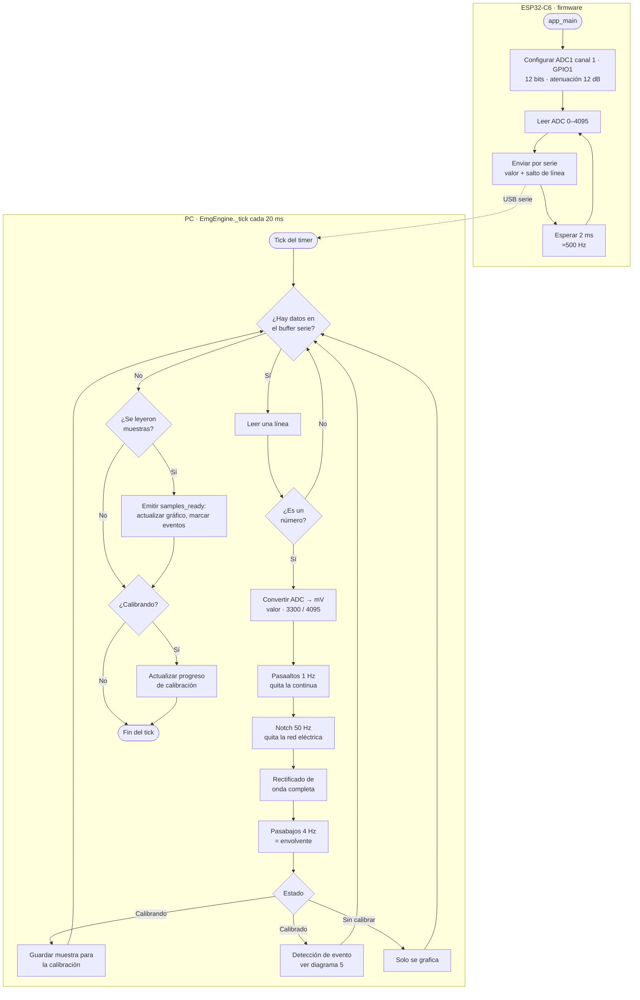
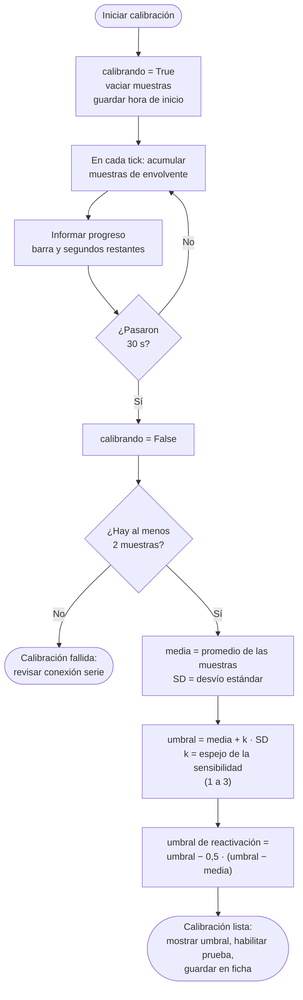
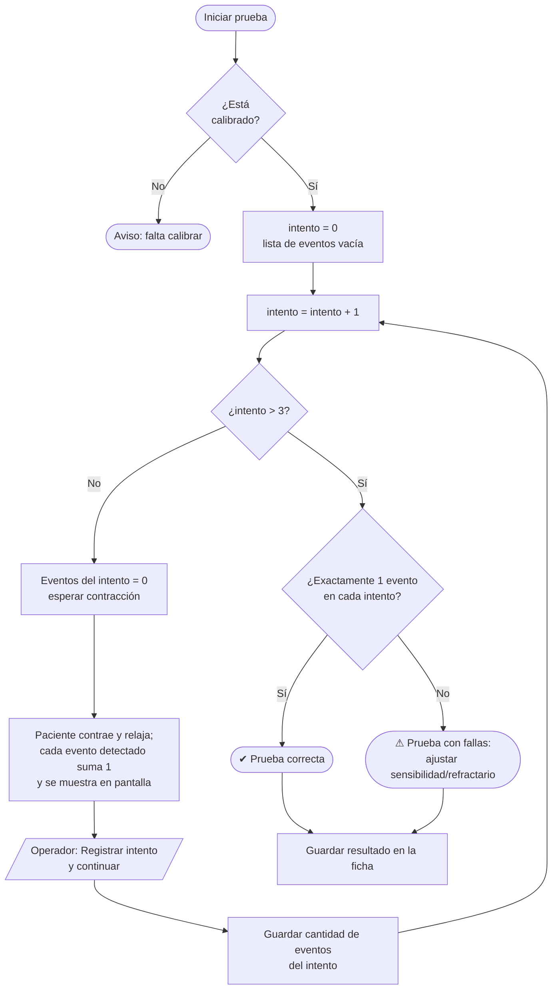
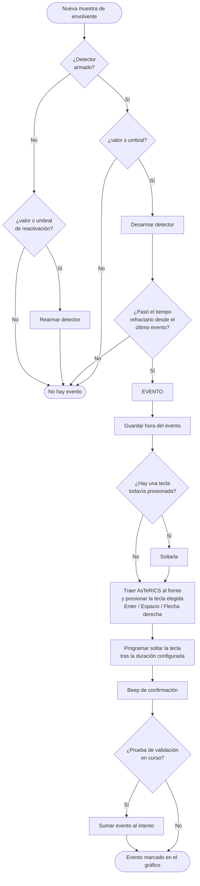

# Diagramas de flujo — Control por EMG

Basados en el código actual de:

- `firmware/emg_esp32/main/emg_esp32.c` (adquisición)
- `interfaz/pages/emg_page.py` (inicio de sesión)
- `interfaz_emg/emg/interfazEmg.py` → `EmgEngine` (lógica)
- `interfaz/pages/emg/emg_main_page.py` y `emg_live_widget.py` (pantalla)

Se pueden pegar en [mermaid.live](https://mermaid.live) para exportarlos como PNG/SVG.

---

## 1. Flujo general de la sesión EMG

```mermaid
flowchart TD
    A([Inicio: el operador elige EMG para el paciente]) --> B{¿Ya hay una<br/>sesión EMG activa?}
    B -- Sí --> B1[Mostrar aviso de<br/>calibración requerida] --> P
    B -- No --> C[Detección automática del puerto:<br/>probar cada puerto serie y buscar<br/>≥2 líneas numéricas de la ESP32]
    C --> D{¿Se encontró<br/>la ESP32?}
    D -- No --> E[Diálogo: elegir puerto<br/>manualmente]
    E --> F{¿Puerto<br/>elegido?}
    F -- No --> X([Fin: no se abre la pantalla EMG])
    D -- Sí --> G
    F -- Sí --> G[Abrir puerto serie<br/>115200 baudios]
    G --> H{¿Se pudo<br/>abrir?}
    H -- No --> H1[Mensaje de error] --> X
    H -- Sí --> I[Crear EmgEngine y EmgMainPage]
    I --> J["Vincular ficha del paciente:<br/>restaurar sensibilidad, refractario,<br/>tecla, duración y barrido<br/>(no el umbral)"]
    J --> K[Aviso: calibración requerida]
    K --> L[Arrancar timer de lectura<br/>cada 20 ms]
    L --> P

    P[Pantalla EMG: señal en vivo] --> Q[/Operador: Iniciar calibración/]
    Q --> R[Calibración 30 s en reposo<br/>ver diagrama 3]
    R --> S{¿Calibración<br/>exitosa?}
    S -- No --> Q
    S -- Sí --> T[Umbral calculado:<br/>se dibuja en el gráfico<br/>y se guarda en la ficha]
    T --> U{¿Prueba de<br/>validación?}
    U -- Omitir --> W
    U -- Iniciar --> V[Prueba de 3 contracciones<br/>ver diagrama 4]
    V --> V1{¿1 evento en<br/>cada intento?}
    V1 -- No --> V2[Ajustar sensibilidad<br/>y/o refractario] --> U
    V1 -- Sí --> W
    W[/Operador: Abrir AsTeRICS/] --> W1[Abrir AsTeRICS maximizado en el<br/>monitor del paciente y enviarle<br/>modo barrido, tiempo de barrido<br/>y duración de pulsación]
    W1 --> Y[Uso: cada contracción detectada<br/>envía una tecla a AsTeRICS]
    Y --> Z{¿Se cambian<br/>parámetros?}
    Z -- Sí --> Z1[Recalcular umbral, guardar en ficha<br/>y avisar: repetir validación] --> U
    Z -- No --> Y
    Y --> FIN([Cierre: detener timer, soltar tecla,<br/>cerrar puerto y AsTeRICS])
```

---

## 2. Adquisición y procesamiento de cada muestra

---

## 3. Calibración

---

## 4. Prueba de validación (3 contracciones)

---

## 5. Detección de eventos (comparador con histéresis + refractario)

